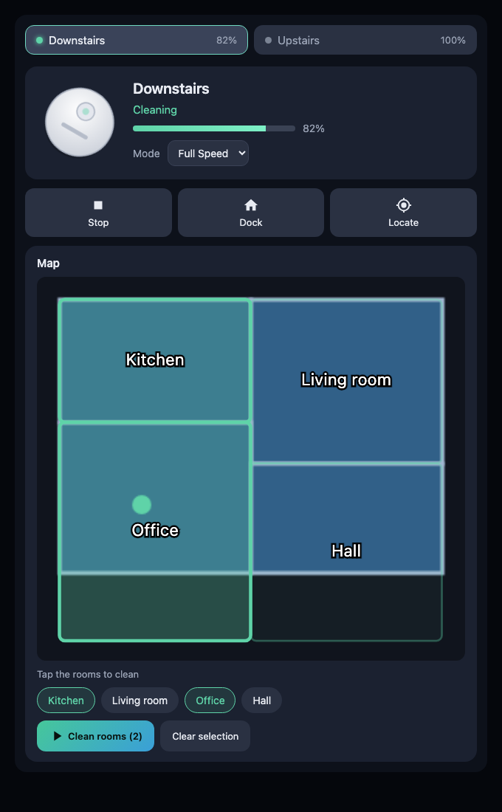
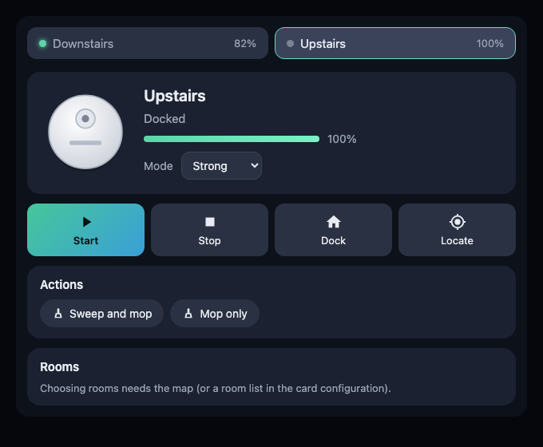

# Vacuum Hub

[](https://github.com/hacs/integration)
[](https://github.com/dmdias/ha-vacuum-hub/releases)
[](https://github.com/dmdias/ha-vacuum-hub/actions/workflows/validate.yml)
[](LICENSE)
[](https://www.paypal.com/donate/?business=dmdias%40gmail.com&currency_code=EUR&item_name=Vacuum+Hub)

Control several robot vacuums from one Home Assistant card. Pick a
vacuum, see its live map, and send it to the rooms you choose, without
the Mi Home app.

It was made for households with Xiaomi ecosystem vacuums on different
Xiaomi cloud servers (for example one on the China server and one on the
Europe server). The app makes you log out and back in to switch between
servers, and it often fails to log in at all. Home Assistant keeps both
connected.

| Room cleaning on the map | Controls and mopping |
|---|---|
|  |  |

## Contents

- [What you get](#what-you-get)
- [How it works](#how-it-works)
- [Requirements](#requirements)
- [Installation](#installation)
  - [Step 1: Xiaomi Home (the vacuums)](#step-1-xiaomi-home-the-vacuums)
  - [Step 2: Xiaomi Cloud Map Extractor (the maps)](#step-2-xiaomi-cloud-map-extractor-the-maps)
  - [Step 3: Vacuum Hub](#step-3-vacuum-hub)
  - [Step 4: Add the card](#step-4-add-the-card)
  - [Step 5: Name the rooms](#step-5-name-the-rooms)
- [Card configuration](#card-configuration)
- [The `vacuum_hub.clean_rooms` action](#the-vacuum_hubclean_rooms-action)
- [Supported vacuums](#supported-vacuums)
- [Troubleshooting](#troubleshooting)
- [Development](#development)
- [Support the project](#support-the-project)
- [Author](#author)
- [License](#license)

## What you get

- **One card for all your vacuums**: a button per vacuum at the top, with its
  state and battery.
- **Controls**: start, pause, stop, return to dock and locate. Only the
  buttons a vacuum supports are shown.
- **Suction mode**, and **device actions** such as *sweep and mop* or *mop
  only*.
- **Live map** of each vacuum, which refreshes on its own while it cleans
  and zooms in automatically on the drawn area, leaving out the empty space
  around it.
- **Room cleaning**: tap rooms on the map (or their buttons) and clean only
  those. This runs over your local network, so it works even when the Xiaomi
  cloud does not offer it.
- **Nothing to register**: the integration loads the card on every dashboard
  for you, and updates reach the browser without clearing caches.
- Portuguese and English texts, following your Home Assistant language.

## How it works

Vacuum Hub ties together three pieces:

| Piece | What it does | Required for |
|---|---|---|
| [Xiaomi Home](https://github.com/XiaoMi/ha_xiaomi_home) (official Xiaomi integration) | Creates the `vacuum.*` entities, mode selects and action buttons through the Xiaomi cloud | Controls, state, battery, mode, mopping |
| [Xiaomi Cloud Map Extractor](https://github.com/PiotrMachowski/Home-Assistant-custom-components-Xiaomi-Cloud-Map-Extractor) **v3** | Downloads the map from the Xiaomi cloud, with the room outlines and ids. Also stores each vacuum's local IP and token | Map, room selection, room cleaning |
| **Vacuum Hub** (this repository) | Serves the card. Adds the `vacuum_hub.clean_rooms` action, which sends the room cleaning command straight to the vacuum over the local network (miio protocol), using the IP and token from Map Extractor | The card, room cleaning |

Room cleaning is local because the cloud API of many of these vacuums cannot
clean selected rooms. The Viomi V8, for instance, only offers whole-house
cleaning in the cloud.

The card works with any `vacuum.*` entity for the basic controls. Maps and
room cleaning need the other two pieces.

## Requirements

- **Home Assistant 2024.12** or newer.
- **[HACS](https://hacs.xyz/)**, to install the three integrations.
- The vacuums and Home Assistant on the **same local network**: Home
  Assistant must reach the vacuum on UDP port 54321 for room cleaning.
- A **fixed IP for each vacuum**, set as a DHCP reservation in your router.
  Map Extractor stores the IP it found; if the vacuum gets a new one, room
  cleaning stops until you reconfigure it.
- The **Mi Home app** on your phone, logged in, only once: to scan the QR
  code when adding the maps.

Python dependency: [`python-miio`](https://github.com/rytilahti/python-miio)
(≥ 0.5.12). Home Assistant installs it for you; it is usually already there
because Map Extractor uses it too.

## Installation

### Step 1: Xiaomi Home (the vacuums)

Skip this step if your vacuums already show up in Home Assistant.

1. HACS → search **Xiaomi Home** → **Download**, then restart Home Assistant.
2. **Settings → Devices & services → Add integration → Xiaomi Home**, and log
   in with your Xiaomi account.
3. Choose the **cloud server** your vacuum is registered on (for example
   *China* or *Europe*). If you have vacuums on several servers, add the
   integration once per server.
4. Check that each vacuum appears as a `vacuum.*` entity.

> Home Assistant 2026.x also ships a core integration named "Xiaomi Home"
> (domain `xiaomi_miio`). It is a different integration and is not needed
> here.

### Step 2: Xiaomi Cloud Map Extractor (the maps)

Vacuum Hub needs **version 3**, which is still a beta. Version 2 is
configured in YAML, cannot log in when Xiaomi asks for a verification
code, and does not store the IP and token where Vacuum Hub reads them.

1. HACS → search **Xiaomi Cloud Map Extractor** → open it → **⋮ → Redownload**.
2. Turn on **Show beta versions**, choose the newest **v3.0.0** version
   (tested with `v3.0.0-alpha-24`), and download it.
3. Restart Home Assistant.
4. **Settings → Devices & services → Add integration → Xiaomi Cloud Map
   Extractor**.
5. Choose **QR code** login. In the Mi Home app, open the **Profile** tab, tap
   the scan icon (top right) and scan the code shown in Home Assistant.
6. Pick the server and the vacuum. In *Confirm detected device configuration*
   keep the detected **IP**, **token** and **map API** (marked with `*`, for
   example *Roborock* or *Viomi*) and press **Submit**.
7. Repeat for every vacuum.

Each vacuum now has an `image.<name>_live_map` entity with its map.

### Step 3: Vacuum Hub

1. HACS → **⋮ → Custom repositories** → add
   `https://github.com/dmdias/ha-vacuum-hub` with type **Integration**.

   [](https://my.home-assistant.io/redirect/hacs_repository/?owner=dmdias&repository=ha-vacuum-hub&category=integration)
2. Search **Vacuum Hub** → **Download**.
3. Restart Home Assistant.
4. **Settings → Devices & services → Add integration → Vacuum Hub** →
   **Submit**. There is nothing to configure.

   [](https://my.home-assistant.io/redirect/config_flow_start/?domain=vacuum_hub)
5. Reload the browser, so it loads the card.

### Step 4: Add the card

Edit a dashboard → **Add card** → **Vacuum Hub**, or a **Manual** card:

```yaml
type: custom:vacuum-hub-card
vacuums:
  - entity: vacuum.downstairs
    map: image.mi_robot_vacuum_1s_live_map
  - entity: vacuum.upstairs
    map: image.mi_robot_vacuum_mop_p_live_map
```

Use your own `vacuum.*` and `image.*_live_map` entity ids; you can find them
under **Settings → Entities**. Without `vacuums`, the card shows every vacuum,
without maps.

For a page of its own, create a dashboard view of type **Sidebar** or
**Panel** and put the card in it.

### Step 5: Name the rooms

Many vacuums do not store room names in the map, so rooms appear as
"Room 16", "Room 17", and so on. To name them:

1. Find the room ids: **Developer tools → States** →
   `image.<name>_live_map` → the `rooms` attribute lists every room id. Tap a
   room in the card to see which one is highlighted on the map.
2. Add them to the vacuum in the card configuration:

   ```yaml
   - entity: vacuum.downstairs
     map: image.mi_robot_vacuum_1s_live_map
     rooms:
       16: Kitchen
       17: Garage
       20: Living room
   ```

These names only exist in Home Assistant; the Mi Home app keeps its own.

## Card configuration

| Option | Type | Description |
|---|---|---|
| `vacuums` | list | Vacuums to show, in order. Each item is an entity id or an object with the options below. Default: every `vacuum.*` entity. |

Per vacuum:

| Option | Type | Default | Description |
|---|---|---|---|
| `entity` | string | required | The `vacuum.*` entity. |
| `name` | string | entity name | Name shown in the card. |
| `map` | string | – | Map entity: `image.*_live_map` (Map Extractor v3) or a `camera.*` (v2). |
| `map_zoom` | boolean | `true` | Zoom in on the drawn area of the map (walls, floor and rooms). `false` shows the whole map image. |
| `map_padding` | number | `0.05` | Margin around the zoomed area, as a fraction of its size (`0.1` = 10%). |
| `rooms` | map | names from the map | Room names by id, e.g. `16: Kitchen`. |
| `mode_entity` | string | found on the device | `select.*` entity used for the suction mode, when the vacuum has no fan speeds. |
| `buttons` | list | every button of the device | `button.*` entities shown under *Actions* (for example mopping modes). |
| `battery_entity` | string | found on the device | Battery `sensor.*`, when the vacuum entity has no battery level. |
| `room_service` | object | – | Advanced: clean rooms with your own action instead of Vacuum Hub, e.g. `{service: script.clean_rooms}`. It receives `rooms` (`"16,17"`) and `params` (`[16, 17]`); `vacuum.*` actions also receive `entity_id`. |
| `room_action` | string | found on the device | Advanced: a Xiaomi Home `notify.*` "start room sweep" entity, used when Vacuum Hub cannot clean rooms on that model. |

The mode select, buttons and battery sensor are found through the device of
each vacuum, so you usually only set `entity`, `map` and `rooms`.

For room cleaning, the card uses `room_service` if you set one. Otherwise it
uses the Vacuum Hub action for a [supported vacuum](#supported-vacuums), and
otherwise the Xiaomi Home `room_action`.

## The `vacuum_hub.clean_rooms` action

You can also use room cleaning in automations and scripts:

```yaml
action: vacuum_hub.clean_rooms
data:
  entity_id: vacuum.upstairs
  rooms: [21, 22]
```

For example, clean the kitchen every weekday after dinner:

```yaml
automation:
  - alias: Clean the kitchen after dinner
    triggers:
      - trigger: time
        at: "21:30:00"
    conditions:
      - condition: time
        weekday: [mon, tue, wed, thu, fri]
    actions:
      - action: vacuum_hub.clean_rooms
        data:
          entity_id: vacuum.downstairs
          rooms: [16]
```

The action:
1. Finds the model of the vacuum from its device.
2. Takes the IP and token from the vacuum's Map Extractor entry.
3. Sends the room cleaning command over the local network.

The token is never logged, and it never leaves Home Assistant.

## Supported vacuums

| | Controls, mode, map | Room cleaning (Vacuum Hub) |
|---|---|---|
| Any vacuum with a `vacuum.*` entity | Controls and mode | – |
| Vacuums supported by Map Extractor (Xiaomi, Roborock, Viomi, Roidmi, Dreame) | Map | – |
| **Viomi** (`viomi.vacuum.*`) | ✅ | ✅ tested with `viomi.vacuum.v8` (Mi Robot Vacuum-Mop P) |
| **Roborock / Xiaomi Roborock** (`roborock.vacuum.*`, `rockrobo.vacuum.*`) on Mi Home | ✅ | Implemented with python-miio's segment cleaning (`app_segment_clean`); not confirmed on a real vacuum yet (`roborock.vacuum.m1s` pending) |

- **Viomi:** the cleaning keeps the vacuum's current mode (vacuum or mop).
- **Roborock:** these are vacuums added to the Mi Home app. Vacuums that use
  the Roborock app have their own core integration, and are not covered.

Pull requests for other models are welcome.

## Troubleshooting

**The card does not appear ("Custom element doesn't exist")**
Check that the Vacuum Hub integration is added under **Settings → Devices &
services**, then reload the browser. On the companion app: **Settings →
Companion app → Debugging → Reset frontend cache**.

**There is no "Clean rooms" button**
- The vacuum needs a map with rooms (`map:` set, Step 2).
- The vacuum must be a [supported model](#supported-vacuums).
- The Vacuum Hub integration must be added.

When the vacuum cannot clean rooms, the card says so under the map.

**"No Xiaomi Cloud Map Extractor entry found for …"**
Add that vacuum to Map Extractor **v3** (Step 2). Version 2 YAML
configurations are not read.

**"Could not start room cleaning … timed out"**
- Home Assistant cannot reach the vacuum.
- Check that the IP in the Map Extractor entry is the vacuum's current IP. A
  DHCP reservation keeps it fixed.
- Check that nothing blocks UDP port 54321 between them.

If the vacuum was reset or paired again, its token changed: remove the
vacuum from Map Extractor and add it again.

**The map does not update**
Map Extractor refreshes the map every few seconds while the vacuum cleans,
and less often when it is docked. Check that its *Update map* switch is on
(enable the entity if it is disabled), and that the `image.*_live_map`
entity updates under **Developer tools → States**.

**The map is too small, or zoomed in too much**
The card zooms in on the area of the map image that is drawn on, ignoring
the background colour around it. Use `map_padding` to leave more margin, or
`map_zoom: false` to show the whole image. Cropping in the Map Extractor
options also works and is applied first.

**The rooms on the map are shifted**
The outlines are placed with the calibration points of the map image. If you
crop or rotate the map in the Map Extractor options, reload the page after
the next map update.

**Login problems in the Mi Home app**
Vacuum Hub does not use the app. Xiaomi Home and Map Extractor keep their
own sessions, and room cleaning is local. You only need the app to scan the
QR code once.

## Development

- The card is a single dependency-free file:
  `custom_components/vacuum_hub/frontend/vacuum-hub-card.js`.
- `preview/index.html` runs it against a mocked Home Assistant (two vacuums,
  a map, rooms). Open it in a browser:

  ```
  preview/index.html?index=0&map=1     # first vacuum, with a map
  preview/index.html?index=1           # second vacuum (mop actions)
  preview/index.html?lang=en           # English texts
  preview/index.html?select=16,18      # rooms already selected
  ```

- **Releases:** bump the version in `manifest.json`, `const.py` and
  `CARD_VERSION` (the workflow checks that they match), update the
  [changelog](CHANGELOG.md), and create a GitHub release `vX.Y.Z`.

## Support the project

If Vacuum Hub saves you from the app, you can buy me a coffee ☕. Thank you!

<a href="https://www.paypal.com/donate/?business=dmdias%40gmail.com&currency_code=EUR&item_name=Vacuum+Hub"></a>

Bug reports and ideas are welcome in the [issues](https://github.com/dmdias/ha-vacuum-hub/issues).

## Author

**Daniel Dias** ([@dmdias](https://github.com/dmdias)).

## License

[GPL-3.0](LICENSE).

This project is not affiliated with Xiaomi, Roborock or Viomi. Product names
are trademarks of their owners. Thanks to
[python-miio](https://github.com/rytilahti/python-miio) and
[Xiaomi Cloud Map Extractor](https://github.com/PiotrMachowski/Home-Assistant-custom-components-Xiaomi-Cloud-Map-Extractor),
which make this possible.
